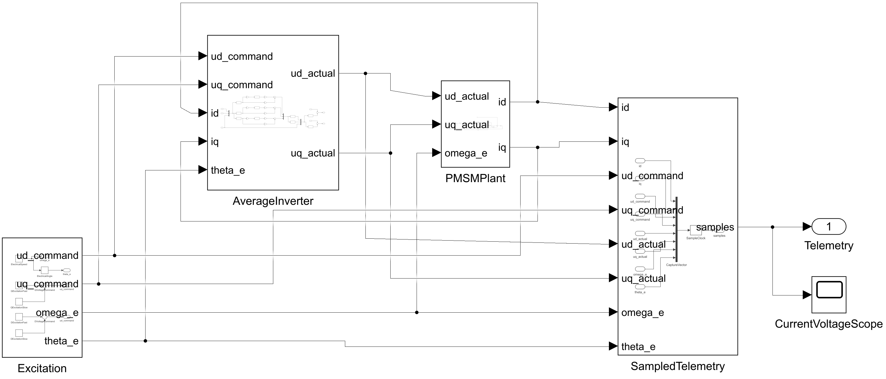

# 永磁电机参数辨识 Skill

## 1. Skill 介绍

`identify-pmsm-parameters` 是一个供 Codex / AI 助手调用的永磁同步电机（PMSM）参数辨识 Skill。它将电机资料、控制板采样和 MATLAB 计算串联起来，帮助使用者从同步采样的电压、电流、电角速度中估计电机参数，并检查结果是否有足够的数据支持。

使用者可以先提供电机手册，让 AI 提取型号、额定值、极对数和反馈信息；已有实验数据时，Skill 会核对单位、坐标系和采样时序，计算定子电阻 Rs、d/q 轴电感 Ld/Lq、永磁磁链 psi_f，再用另一组实验预测电流，输出参数、诊断和验证报告。

适用于 PMSM，以及满足常参数 dq 模型假设、采用 FOC 的无刷电机。没有实测数据时，可以使用随附的标准模块 Simulink 仿真，了解辨识流程和电压误差补偿的作用。

| 能力 | 使用者可以得到什么 |
|---|---|
| 手册信息提取 | 带型号、单位、条件和来源页码的配置资料；缺项保持未知 |
| 电气参数辨识 | Rs、Ld、Lq、psi_f 参数候选；支持独立电感或等电感模型 |
| 数据与可辨识性检查 | 单位、时间、饱和、间断、矩阵秩与条件数诊断 |
| 独立实验验证 | 另一组实验的 d/q 电流预测、误差指标和验收状态 |
| 通用采样接入 | 可适配控制板的 PMI1 C 编码接口、Python 接收与回放工具 |
| 仿真与结果导出 | 标准 Simulink 对比模型，以及 CSV、MAT、JSON 和图表 |

核心辨识采用离线积分加权最小二乘，数值由 MATLAB 计算。手册标称值用于准备实验和对照；辨识结果来自采样记录。项目入口为 [SKILL.md](SKILL.md)，仿真入口见 [Simulink 使用说明](simulink/README.md)。

## 2. 可直接运行的 Simulink 仿真

模型为 [pmsm_id_bench.slx](simulink/pmsm_id_bench.slx)，已嵌入默认参数，打开后可以直接运行。

### Simulink 仿真框架



上图从实际 Simulink 模型导出，点击可查看高清图。框架包括：

| 模块 | 作用 |
|---|---|
| `Excitation` | 生成 dq 电压激励、电角速度和电角度 |
| `AverageInverter` | 加入随相电流变化的逆变器平均电压误差 |
| `PMSMPlant` | 根据实际 dq 电压和速度计算电机电流 |
| `SampledTelemetry` | 同步采集电流、指令/实际电压、速度与角度 |
| `CurrentVoltageScope` / `Telemetry` | 显示波形并输出采样数据 |

图中模型负责产生采样数据；参数辨识、FFNN 电压补偿和独立预测验证由配套 MATLAB 脚本完成。

### 运行仿真与查看结果

完整比较在仓库根目录执行：

```matlab
addpath(fullfile(pwd,'simulink'));
% Set PMSM_SKILL_TMPDIR first if your project specifies a temporary directory.
report = pmsm_run_simulink_benchmark(fullfile(pwd,'output','benchmark_demo'));
assert(report.allChecksPassed);
```

输出目录必须尚不存在，防止覆盖已有结果。运行器会生成结果表、JSON、原始仿真 MAT 和对比图；缓存写入 `PMSM_SKILL_TMPDIR`，未指定时使用系统临时目录。

R2024b 本地比较中，未补偿时 Rs 相对误差约 **37.913%**，独立标定 FFNN 补偿后约 **−0.0179%**；加入 5 mA 电流和 5 mV 电压噪声后，四参数最大绝对相对误差约 **0.246%**。标定漂移案例未通过独立电流预测检查，无激励案例被拒绝；共 **10/10 项仿真检查通过**。


模型、假设、论文思路对应关系、六组完整结果及复现方式见 [仿真说明](simulink/README.md)。这是固定参数、给定速度/角度的平均电压电气仿真；数值不代表论文复现精度或实物精度。FFNN 示例用于离线辨识输入电压补偿，尚未实现在线注入、无位置传感器控制或自动实机标定。

## 3. 参考文献

以下列出可辨识性、逆变器误差及先进辨识路线的主要参考。当前代码为独立编写的离线基线；仿真中的小型 FFNN 示例用于验证电压误差补偿思路。在线注入、观察器与硬件台架方案的实现情况见文末适用范围。

1. Zhu, Z. Q., Liang, D., & Liu, K. (2021). **Online Parameter Estimation for Permanent Magnet Synchronous Machines: An Overview.** *IEEE Access*, 9, 59059–59084. [DOI](https://doi.org/10.1109/ACCESS.2021.3072959)。参数辨识方法及可辨识性综述。
2. Boileau, T., et al. (2011). **Online Identification of PMSM Parameters: Parameter Identifiability and Estimator Comparative Study.** *IEEE Transactions on Industry Applications*, 47(4), 1944–1957. [DOI](https://doi.org/10.1109/TIA.2011.2155010)。可辨识性研究参考，原文精读状态见文献说明。
3. Wang, Q., et al. (2024). **Review of Inductance Identification Methods Considering Inverter Nonlinearity for PMSM.** *Chinese Journal of Electrical Engineering*, 10(2), 1–15. [DOI](https://doi.org/10.23919/CJEE.2023.000046)。逆变器非线性与电感辨识综述。
4. Xiang, F., Zhou, Z., & Wang, Z. (2026). **Online Parameter Identification for Sensorless PMSM Drives with Inverter Nonlinearity Compensation.** *Electronics*, 15(12), 2722. [DOI](https://doi.org/10.3390/electronics15122722)。高频注入与 FFNN 电压补偿，已核验 STM32F407 实物台架；本仓库仿真参考其补偿思路。
5. He, S., et al. (2026). **Online Multi-Parameter Identification for PMSM Parameter Monitoring Based on a ZOH Model and Dual-Sampling Strategy.** *Sensors*, 26(3), 1072. [DOI](https://doi.org/10.3390/s26031072)。ZOH、双采样与 FFRLS，已核验真实电机台架。
6. Wang, P., Zhu, Z. Q., & Liang, D. (2025). **Virtual Signal Injection-Based Online Full-Parameter Estimation of Surface-Mounted PMSMs Without Influence of Position Error and Inverter Nonlinearity.** *IEEE Journal of Emerging and Selected Topics in Power Electronics*, 13(2), 2341–2357. [DOI](https://doi.org/10.1109/JESTPE.2025.3544820)。虚拟信号注入，已核验 SPMSM / IPMSM 原型台架。
7. Wang, P., et al. (2025). **Online Simultaneous Identification of Multi-Parameters for Interior PMSMs Under Sensorless Control.** *CES Transactions on Electrical Machines and Systems*, 9(4), 422–433. [DOI](https://doi.org/10.30941/CESTEMS.2025.00029)。IPMSM 多参数辨识，已核验 400 W 实物台架。
8. Wang, P., Zhu, Z. Q., & Feng, Z. (2026). **Online Parameter Identification of SPMSMs Under Sensorless Control Cancelling Influence of Position Error With Torque Measurements.** *IET Electric Power Applications*, 20(1), e70185. [DOI](https://doi.org/10.1049/elp2.70185)。转矩辅助辨识，已核验真实发电机台架。
9. Wang, P., & Zhu, Z. Q. (2026). **Overview of Online Parameter Identification of Permanent Magnet Synchronous Machines Under Sensorless Control.** *IEEE Access*, 14, 11582–11606. [DOI](https://doi.org/10.1109/ACCESS.2026.3655929)。无位置传感器辨识路线综述。

完整 **17 篇题录**见 [BibTeX](references/references.bib)。各文献的阅读层次与用途见 [论文依据](references/literature.md)；5 篇已核验实物论文的平台、工况和限制见 [实物实验核验](references/hardware-validated-papers.md)。文献中的实物验证与本项目自身的验证分别记录。

## 4. 安装到 Codex

核心辨识需要 **MATLAB 与 JVM**，已在 R2024b 验证。可选仿真另外需要 **Simulink**，只使用标准模块，无需自定义库、Simscape、Motor Control Blockset 或 Deep Learning Toolbox。

采集工具要求 Python 3.10+；离线回放仅需标准库，实时串口另需 pySerial。C 编码器要求 C99、8 位字节与 IEEE-754 binary32，不绑定某个 MCU HAL。其他 MATLAB 版本尚未验证。

将整个仓库放入 Codex 的 skills 目录，文件夹名保持 `identify-pmsm-parameters`。默认目录下可运行：

Windows PowerShell：

```powershell
git clone https://github.com/YANG985-CMD/identify-pmsm-parameters.git "$env:USERPROFILE\.codex\skills\identify-pmsm-parameters"
```

macOS / Linux：

```sh
git clone https://github.com/YANG985-CMD/identify-pmsm-parameters.git ~/.codex/skills/identify-pmsm-parameters
```

如果已设置自定义 `CODEX_HOME`，请安装到该目录下的 `skills`。已有同名安装时先检查其本地改动，再选择更新方式。

调用示例：

> 使用 $identify-pmsm-parameters 检查这份电机采样，辨识电阻、电感和磁链，并用另一组实验验证。

## 5. 先把电机手册交给 AI

不清楚实机接入需要填哪些信息时，可以先向 AI 提供电机手册、产品数据表（PDF、Word 等）或清晰的铭牌图片；有控制板说明书或固件工程时也可一并提供。

可以直接这样说：

> 使用 $identify-pmsm-parameters 阅读我提供的电机手册，提取这个型号的额定参数、极对数、接线和反馈信息，标注来源页码，列出还缺什么；结合已有控制板资料准备辨识配置。

AI 会先核对型号与版本，再整理型号、额定电压/电流/转速、极数/极对数、接线方式、反馈器件，以及手册明确给出的电阻、电感、反电势常数等信息。输出表保留原始单位、条件和来源页码；明确可换算的项目附上换算依据，资料未说明的项目保留“未知”。

| 信息来源 | 可帮助取得的内容 |
|---|---|
| 电机手册/铭牌 | 电机规格、额定值、极对数、接线、所配反馈器件及标称参数 |
| 控制板手册/固件 | 串口配置、ADC 换算、PWM/采样周期、角度算法及电压重建方式 |
| 实际设备与采样 | 当前接线、端口、实测校准、时间对齐、实验工况和两组独立记录 |

能从资料或已有工程读取的信息由 AI 提取，只补问影响当前步骤的缺项与冲突。手册中的额定值用于准备实验；电阻、电感和磁链的辨识结果仍来自真实采样。电机手册本身不能证明控制板当前的电流标定或采样时序正确。

详细读取与证据记录规则见 [手册信息提取](references/manual-intake.md)。

### 采样输入要求

必须有同步的 `t, id, iq, ud, uq, omega_e`：时间 s、电流 A、电压 V、电角速度 rad/s。坐标系为幅值不变 dq，d 轴沿永磁磁链。

元数据必须说明实验 ID、实测或仿真、单位、电压与角度来源、时间对齐情况。完整字段和可选标志见 [数据约定](references/data-contract.md)。只有转速或速度环 PI 日志不足以识别完整电气参数。

## 6. 通用实物接入

统一“板卡适配 → 同步采样记录 → 上位机接收 → MATLAB 辨识 → 独立实验验证”。各板卡需映射实际的时间戳、id/iq、ud/uq、电角速度、有效/饱和状态；算法与上位机流程共用。

- [通用接入说明](references/hardware-integration.md)：板端适配、采样时序、带宽、串口/文件调用和实验路线。
- [C 端接口](firmware/pmsm_capture.h)：固定 48 字节 PMI1 编码，独立于 HAL，不负责启动或控制电机。
- [元数据模板](assets/hardware-meta.example.json)：按实际来源填写，未知项保留为未知。

现有正确的 SI dq CSV 可直接走原接口。新板适配 PMI1 后，每次采集保存原始记录、CSV、元数据及 SHA-256 摘要；丢帧和坏帧形成实验边界，时钟回退或重启会被拒绝。两组独立采集目录可直接运行 `pmsm_identify_capture` 完成校验、估计、验证和导出。

这是一套可适配多种控制板的数据接口；还没有在具体板卡上完成实测。自动注入测试电流、电机启停、参数下发、CAN 分片接收及刷写仍需要具体硬件实现。

## 7. MATLAB 辨识与独立验证

典型流程为：资料准备与同步采样 → 数据检查 → 参数估计与可辨识性检查 → 另一组实验验证 → 导出参数及诊断。支持 MATLAB table、CSV 和包含 data table 的 MAT 文件。

信息不足时会返回 `not_identifiable` 或 `ill_conditioned`；有来源的先验参数可通过 `Fixed` 固定，只估计数据能够支持的部分。另一实验必须具有独立记录，文件改名不能替代独立验证。详细规则见 [算法说明](references/algorithms.md)。

以下为无硬件的合成数据入门示例。在 MATLAB 仓库根目录运行：

```matlab
previousPath = path;
pathCleanup = onCleanup(@() path(previousPath));
addpath(fullfile(pwd,'scripts'));

[trainData,trainMeta,truth] = pmsm_simulated_experiment();
[holdoutData,holdoutMeta] = pmsm_simulated_experiment( ...
    ExperimentID="synthetic-holdout",Phase=0.8);

estimate = pmsm_identify_electrical(trainData,trainMeta, ...
    Model="ipmsm",WindowSamples=10);
disp(estimate.status);
disp(estimate.parameters);

% 0.01 A is a synthetic-test criterion, not a real-motor accuracy claim.
validation = pmsm_validate_electrical(estimate,holdoutData,holdoutMeta, ...
    MaxRMSE=[0.01,0.01]);
disp(validation.status);
disp(validation.rmseAmps);

clear pathCleanup
```

真实数据的验收阈值应有控制需求或测量精度依据；不设置 `MaxRMSE` 时只报告预测指标。导出方式及失败状态见 [算法说明](references/algorithms.md)。

## 8. 仓库内容与测试

| 路径 | 用途 |
|---|---|
| [SKILL.md](SKILL.md) | AI 调用 Skill 时的工作规则与资源入口 |
| [scripts](scripts) | MATLAB 辨识、数据审查、独立验证、导出，以及 Python 采集工具 |
| [firmware](firmware) | 可适配控制板的 PMI1 C 端记录编码 |
| [assets](assets) | 实物接入元数据模板 |
| [simulink](simulink) | 标准模块模型、补偿实验、运行说明与参考结果 |
| [references](references) | 数据约定、算法、手册提取、硬件接入及文献 |
| [tests](tests) | MATLAB 与 Python 的软件行为测试 |

在 MATLAB 的仓库根目录运行：

```matlab
testResults = runtests(fullfile(pwd,'tests'),'IncludeSubfolders',false);
assertSuccess(testResults);
```

MATLAB 包含 28 项测试，覆盖原有辨识功能，以及采集包完整性、失败记录拒绝和从采集包到导出的流程。协议/接收器另有 20 项 Python 测试（包括 C 编码交叉校验；该项需要先生成 C fixture）。两组本地测试均通过；没有打开真实串口或启动电机。

Python 测试：

```sh
python -B tests/test_capture.py -v
```

完整 C 交叉校验：先将 `firmware/pmsm_capture.c` 与 `tests/capture_wire_fixture.c` 编译为测试程序，运行该程序并传入临时二进制输出路径，再将 `PMSM_C_FIXTURE` 设为该路径后运行 Python 测试。未设置时，该交叉校验项会明确跳过。编译产物和 fixture 均放入用户或项目指定的临时任务目录。

测试通过代表合成模型与程序行为验证，不能代替真实电机实验。

测试文件使用环境变量 `PMSM_SKILL_TMPDIR` 指定临时根目录；未设置时使用 MATLAB `tempdir`。如果用户或项目规定了临时文件位置，运行前必须设置该变量。每次文件测试只清理其独立子目录中的已知输出。

## 9. 当前适用范围

当前提供离线电气参数辨识、通用采样接口和仿真验证。在线 RLS/EKF、机械 J/B 辨识、自动实机死区补偿、磁饱和图、控制器参数下发及自动实机实验尚未实现；采集接收结束也不会停止电机。

本项目已有软件与合成仿真验证，具体控制板和电机的物理验收仍需完成。预测通过不证明参数真值精度，元数据声明也不能证明传感器校准正确。实机验收还需要可信电压、位置与时序、适当激励，以及明确条件下的参数参考。

仓库提供独立实现的代码、文献题录与核验说明，不包含论文原文、用户实测数据或账户配置。
