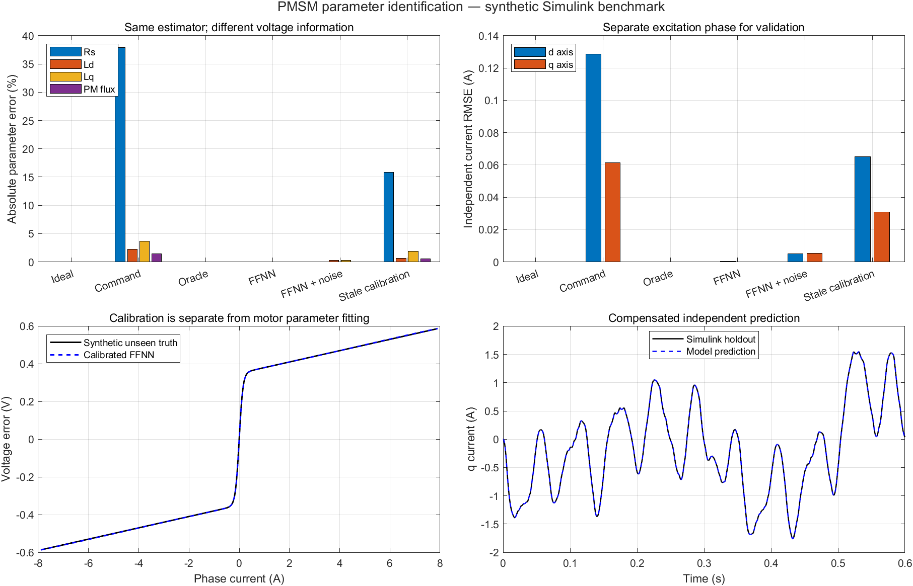

# 永磁电机参数辨识 Skill

A Codex skill for offline PMSM electrical parameter identification and independent current-prediction validation in MATLAB.

从同步采样的电压、电流和电角速度估计永磁同步电机的电气参数，检查数据质量与可辨识性，并用另一组实验预测电流。适用于 PMSM，以及满足常参数 dq 模型假设、采用 FOC 的无刷电机。

## 先把电机手册交给 AI

不清楚实机接入需要填哪些信息时，可以先向 AI 提供电机手册、产品数据表（PDF、Word 等）或清晰的铭牌图片；有控制板说明书或固件工程时也可一并提供。

可以直接这样说：

> 使用 $identify-pmsm-parameters 阅读我提供的电机手册，提取这个型号的额定参数、极对数、接线和反馈信息，标注来源页码，列出还缺什么；结合已有控制板资料准备辨识配置。

AI 会先核对型号与版本，再整理型号、额定电压/电流/转速、极数/极对数、接线方式、反馈器件，以及手册明确给出的电阻、电感、反电势常数等信息。输出表保留原始单位、条件和来源页码；明确可换算的项目附上换算依据，资料未说明的项目保留“未知”。

| 信息来源 | 可帮助取得的内容 |
|---|---|
| 电机手册/铭牌 | 电机规格、额定值、极对数、接线、所配反馈器件及标称参数 |
| 控制板手册/固件 | 串口配置、ADC 换算、PWM/采样周期、角度算法及电压重建方式 |
| 实际设备与采样 | 当前接线、端口、实测校准、时间对齐、实验工况和两组独立记录 |

能从资料或已有工程读取的信息由 AI 提取，只补问影响当前步骤的缺项与冲突。手册中的额定值用于准备实验；电阻、电感和磁链的辨识结果仍来自真实采样。电机手册本身不能证明控制板当前的电流标定或采样时序正确。

详细读取与证据记录规则见 [手册信息提取](references/manual-intake.md)。

## 功能

| 功能 | 第一版实现 |
|---|---|
| 参数估计 | Rs、Ld、Lq、永磁磁链 psi_f；IPMSM 或等电感 SPMSM |
| 算法 | 离线积分加权最小二乘，可固定有依据的先验参数 |
| 输入 | MATLAB table、CSV、包含 data table 的 MAT |
| 数据检查 | 单位声明、时间顺序、无效值、饱和、间断、实验段边界 |
| 可辨识性 | 回归矩阵秩与归一化条件数；信息不足时报告失败状态 |
| 独立验证 | 另一实验的连续 d/q 电流预测；阻止相同数字记录改名复用 |
| 导出 | 参数 CSV、完整 MAT、诊断 JSON、实测与预测电流 CSV |
| 通用实机接入 | C99 PMI1 板端编码、Python 串口接收/文件回放、采集包完整性检查 |
| Simulink 验证 | 标准模块电气模型，比较指令电压、独立标定 FFNN 补偿、噪声与标定漂移 |

已在 **MATLAB R2024b** 验证，使用基础 MATLAB 与 JVM。尚未验证其他 MATLAB 版本。采集工具要求 Python 3.10+；离线回放仅需标准库，实时串口另需 pySerial。C 编码器要求 8 位字节与 IEEE-754 binary32；不绑定某个 MCU HAL。

可选的仿真包另外需要 **Simulink**，使用标准模块，无需自定义库、Simscape、Motor Control Blockset 或 Deep Learning Toolbox。

## 通用实物接入

统一“板卡适配 → 同步采样记录 → 上位机接收 → MATLAB 辨识 → 独立实验验证”。各板卡需映射实际的时间戳、id/iq、ud/uq、电角速度、有效/饱和状态；算法与上位机流程共用。

- [通用接入说明](references/hardware-integration.md)：板端适配、采样时序、带宽、串口/文件调用和实验路线。
- [C 端接口](firmware/pmsm_capture.h)：固定 48 字节 PMI1 编码，独立于 HAL，不负责启动或控制电机。
- [元数据模板](assets/hardware-meta.example.json)：按实际来源填写，未知项保留为未知。

现有正确的 SI dq CSV 可直接走原接口。新板适配 PMI1 后，每次采集保存原始记录、CSV、元数据及 SHA-256 摘要；丢帧和坏帧形成实验边界，时钟回退或重启会被拒绝。两组独立采集目录可直接运行 `pmsm_identify_capture` 完成校验、估计、验证和导出。

这是一套可适配多种控制板的数据接口；还没有在具体板卡上完成实测。自动注入测试电流、电机启停、参数下发、CAN 分片接收及刷写仍需要具体硬件实现。

## 安装到 Codex

将整个仓库放入 Codex 的 skills 目录，文件夹名保持 `identify-pmsm-parameters`。默认目录下可运行：

Windows PowerShell：

```powershell
git clone https://github.com/YANG985-CMD/identify-pmsm-parameters.git "$env:USERPROFILE\.codex\skills\identify-pmsm-parameters"
```

macOS / Linux：

```sh
git clone https://github.com/YANG985-CMD/identify-pmsm-parameters.git ~/.codex/skills/identify-pmsm-parameters
```

如果已设置自定义 `CODEX_HOME`，请安装到该目录下的 `skills`。已有同名安装时先检查其本地改动，再选择更新方式。

调用示例：

> 使用 $identify-pmsm-parameters 检查这份电机采样，辨识电阻、电感和磁链，并用另一组实验验证。

## 输入要求

必须有同步的 `t, id, iq, ud, uq, omega_e`：时间 s、电流 A、电压 V、电角速度 rad/s。坐标系为幅值不变 dq，d 轴沿永磁磁链。

元数据必须说明实验 ID、实测或仿真、单位、电压与角度来源、时间对齐情况。完整字段和可选标志见 [数据约定](references/data-contract.md)。只有转速或速度环 PI 日志不足以识别完整电气参数。

## MATLAB 合成示例

将 MATLAB 当前目录切换到仓库根目录，运行：

```matlab
previousPath = path;
pathCleanup = onCleanup(@() path(previousPath));
addpath(fullfile(pwd,'scripts'));

[trainData,trainMeta,truth] = pmsm_simulated_experiment();
[holdoutData,holdoutMeta] = pmsm_simulated_experiment( ...
    ExperimentID="synthetic-holdout",Phase=0.8);

estimate = pmsm_identify_electrical(trainData,trainMeta, ...
    Model="ipmsm",WindowSamples=10);
disp(estimate.status);
disp(estimate.parameters);

% 0.01 A is a synthetic-test criterion, not a real-motor accuracy claim.
validation = pmsm_validate_electrical(estimate,holdoutData,holdoutMeta, ...
    MaxRMSE=[0.01,0.01]);
disp(validation.status);
disp(validation.rmseAmps);

clear pathCleanup
```

真实数据的验收阈值应有控制需求或测量精度依据；不设置 `MaxRMSE` 时只报告预测指标。导出方式及失败状态见 [算法说明](references/algorithms.md)。

## 运行测试

在 MATLAB 的仓库根目录运行：

```matlab
testResults = runtests(fullfile(pwd,'tests'),'IncludeSubfolders',false);
assertSuccess(testResults);
```

MATLAB 包含 28 项测试，覆盖原有辨识功能，以及采集包完整性、失败记录拒绝和从采集包到导出的流程。协议/接收器另有 20 项 Python 测试（包括 C 编码交叉校验；该项需要先生成 C fixture）。两组本地测试均通过；没有打开真实串口或启动电机。

Python 测试：

```sh
python -B tests/test_capture.py -v
```

完整 C 交叉校验：先将 `firmware/pmsm_capture.c` 与 `tests/capture_wire_fixture.c` 编译为测试程序，运行该程序并传入临时二进制输出路径，再将 `PMSM_C_FIXTURE` 设为该路径后运行 Python 测试。未设置时，该交叉校验项会明确跳过。编译产物和 fixture 均放入用户或项目指定的临时任务目录。

测试通过代表合成模型与程序行为验证，不能代替真实电机实验。

测试文件使用环境变量 `PMSM_SKILL_TMPDIR` 指定临时根目录；未设置时使用 MATLAB `tempdir`。如果用户或项目规定了临时文件位置，运行前必须设置该变量。每次文件测试只清理其独立子目录中的已知输出。

## 可直接运行的 Simulink 仿真

模型为 [pmsm_id_bench.slx](simulink/pmsm_id_bench.slx)，已嵌入默认参数，打开后可以直接运行。完整比较在仓库根目录执行：

```matlab
addpath(fullfile(pwd,'simulink'));
% Set PMSM_SKILL_TMPDIR first if your project specifies a temporary directory.
report = pmsm_run_simulink_benchmark(fullfile(pwd,'output','benchmark_demo'));
assert(report.allChecksPassed);
```

输出目录必须尚不存在，防止覆盖已有结果。运行器会生成结果表、JSON、原始仿真 MAT 和对比图；缓存写入 `PMSM_SKILL_TMPDIR`，未指定时使用系统临时目录。

R2024b 本地比较中，未补偿时 Rs 相对误差约 **37.913%**，独立标定 FFNN 补偿后约 **−0.0179%**；加入 5 mA 电流和 5 mV 电压噪声后，四参数最大绝对相对误差约 **0.246%**。标定漂移案例未通过独立电流预测检查，无激励案例被拒绝；共 **10/10 项仿真检查通过**。



模型、假设、论文思路对应关系、六组完整结果及复现方式见 [仿真说明](simulink/README.md)。这是固定参数、给定速度/角度的平均电压电气仿真；数值不代表论文复现精度或实物精度。FFNN 示例用于离线辨识输入电压补偿，尚未实现在线注入、无位置传感器控制或自动实机标定。

## 实现范围与论文

尚未实现在线 RLS/EKF、机械 J/B 辨识、自动死区补偿、磁饱和图、电机控制指令或自动实机实验；采集接收结束也不会停止电机。预测通过不证明参数真值精度，元数据检查也不能证明传感器校准正确。

本实现是独立编写的积分最小二乘基线。论文阅读层次、适用条件与扩展建议见 [论文依据](references/literature.md)，17 篇题录见 [BibTeX](references/references.bib)。仓库不包含论文原文、用户实测数据或账户配置。

新增 [2025–2026 年先进论文与实物实验核验](references/hardware-validated-papers.md)：5 篇已核对真实台架的论文，以及尚未核验实验章节的前沿候选。文献中的在线算法、注入和补偿属于扩展研究，当前代码没有因此自动具备这些功能。

Skill 入口见 [SKILL.md](SKILL.md)。
