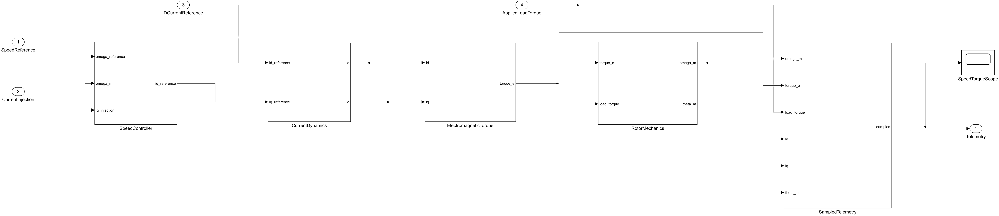
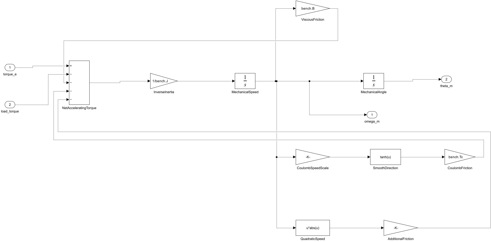
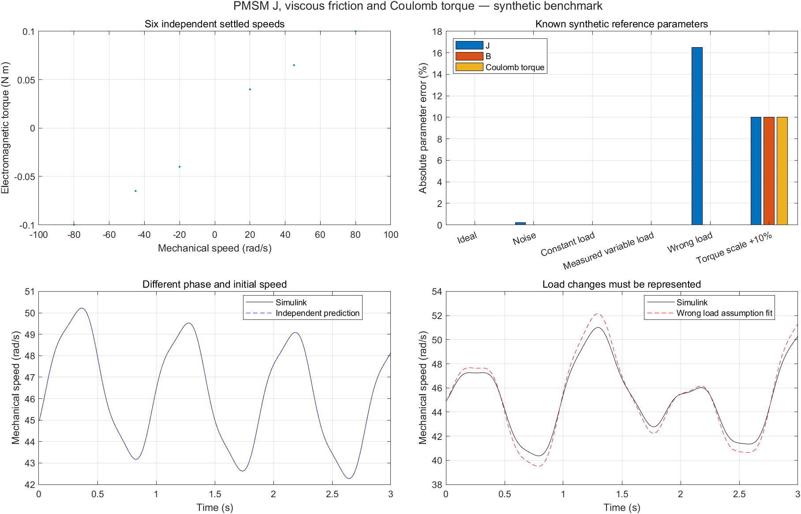

# PMSM J/B/Tc 标准模块仿真

[pmsm_mechanical_bench.slx](pmsm_mechanical_bench.slx) 增加实际机械状态：转矩经过惯量和摩擦产生转速，再积分得到转角。它与原来的给定速度电气台架并列，原来的 Rs/Ld/Lq/磁链仿真保留。





## 组成与默认参数

| 子系统 | 作用 |
|---|---|
| SpeedController | 示例速度 PI、电流注入及限幅；稳速试验启用，动态转矩试验关闭 |
| CurrentDynamics | 2 ms 一阶 d/q 电流环响应，实际电流是积分状态 |
| ElectromagneticTorque | 永磁与磁阻转矩，用实际 id/iq 计算 Te |
| RotorMechanics | J、黏性摩擦、平滑库仑摩擦、外负载与转速/角度积分 |
| SampledTelemetry | 同步输出速度、Te、外负载、id/iq、转角 |

默认 J=0.002 kg·m²、B=0.001 N·m·s/rad、Tc=0.02 N·m；极对数 3、磁链 0.03 Wb、Ld/Lq=4/6 mH。机械模型用 `Tc*tanh(omega_m/0.2)` 平滑过零；辨识排除 |omega_m|<2 rad/s，采用符号库仑模型。额外二次摩擦默认零，便于扩展失配分析。求解器 ode4，100 μs 固定步长，1 ms 采样；完整参数在 [pmsm_mechanical_defaults.m](pmsm_mechanical_defaults.m)。

本台架是简化 FOC 电流响应＋PMSM 转矩＋刚性机械模型。没有完整 dq 电压电气动态、PWM 开关、逆变器续流、柔性轴或实机控制接口。电气模型的验证继续由原台架完成，不能把这里的一阶电流环称为完整控制器或实物复现。

## 一键对比

在项目根目录运行：

```matlab
addpath('scripts','simulink');
setenv('PMSM_SKILL_TMPDIR','E:/simulink/_codex_tmp/pmsm-mechanical-example');
report = pmsm_run_mechanical_benchmark('output/mechanics-001');
assert(report.allChecksPassed);
```

使用新输出目录，临时任务目录按自己的环境调整。输出完整合成记录 MAT、JSON、CSV 和结果图。缓存写到 `PMSM_SKILL_TMPDIR`。仅需 MATLAB、Simulink 和 JVM，无自定义模块库。

模型工作区已有 `bench` 默认值；直接打开并运行时，未给外部输入的端口为零，展示从初始速度衰减的机械响应。辨识对比须使用运行器，它通过 `SimulationInput` 和 Dataset 设置四个输入：速度参考、电流注入、d 轴参考电流、外负载。

第一阶段模拟 −80、−45、−20、20、45、80 rad/s 六个稳速试验，每次运行 8 s，取最后 2 s 拟合 B/Tc。第二阶段使用两频率电流注入激发速度变化，训练相位为 0，验证为 0.8 rad，初始速度分别为 35/45 rad/s；辨识积分窗口为 100 个间隔。

## 参考结果

| 合成案例 | J 相对误差 | 独立速度 RMSE（rad/s） | 预测状态 |
|---|---:|---:|---|
| 理想数据 | −0.00309% | 0.001145 | 通过 |
| 0.02 rad/s 速度噪声、0.1 mN·m 转矩噪声 | −0.1994% | 0.02138 | 通过 |
| 未知恒定负载 0.03 N·m，同时拟合 J/负载 | −0.00383% | 0.000988 | 通过 |
| 实测变化负载 | −0.00324% | 0.001292 | 通过 |
| 错把变化负载声明为常数 | −16.479% | 0.56373 | 失败 |
| 三组实验的转矩尺度共同增加 10% | +9.9966% | 0.001141 | 通过，但参数尺度错误 |



最后一个案例同时使 B/Tc 约偏移 10%，表明同源尺度错误可能躲过速度预测。真实实验仍需独立转矩尺度/仪器校准依据。未知恒定负载案例的验证使用另一次已知负载实验，未把训练负载估计默认为验证负载。

10 项检查覆盖：B/Tc 与 J 理想恢复各小于 0.5%；独立速度 RMSE 小于 0.1 rad/s；带噪三个参数误差各小于 3%；未知恒定负载和实测变化负载的 J 恢复；错误负载假设预测失败；共同尺度偏差被显式记录；恒速不能辨识 J；减半求解步长的速度差小于 0.01 rad/s。噪声种子为 31/32。完整数值、模型 SHA-256 和设置见 [mechanical-benchmark.json](mechanical-reference-results/mechanical-benchmark.json)。

图由实际模型导出，顶层关闭内部预览；交付时逐层检查布局和连接。仿真通过不表示实机通过，也不表示复现了参考论文的在线观测器或非线性摩擦算法。
